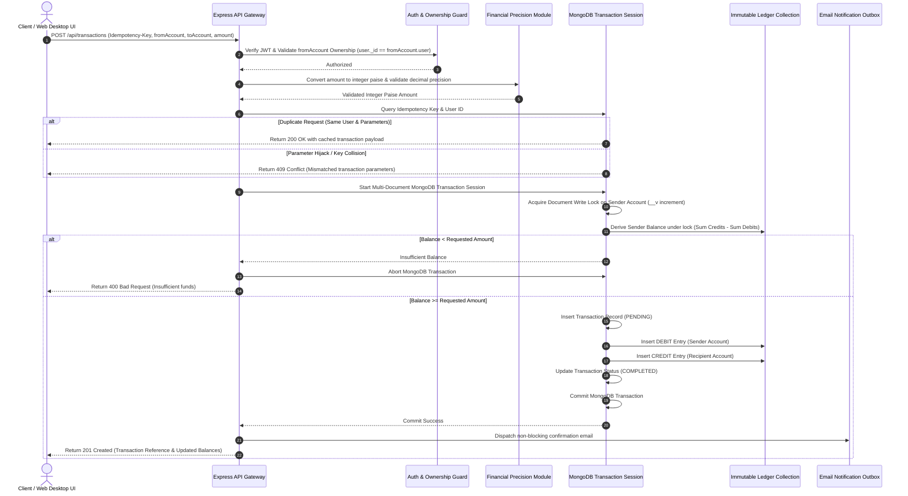

# 🏦 TRANSACT 2.0 — Banking Transaction Management System

[](https://nodejs.org/)
[](https://expressjs.com/)
[](https://react.dev/)
[](https://www.mongodb.com/)
[](https://helmetjs.github.io/)
[-brightgreen.svg)](Backend/test_suite.js)
[](Backend/package.json)

**TRANSACT 2.0** is a full-stack fintech banking platform and ledger management system built with an **immutable double-entry accounting ledger**, **integer sub-paise monetary precision**, **atomic multi-document MongoDB transactions**, **cryptographic idempotency protection**, **formula-injection-safe CSV exports**, **automated ledger reconciliation**, and a **custom dark glassmorphism Web Desktop UI**.

---

## 📋 Table of Contents

- [1. Project Overview](#1-project-overview)
- [2. Key Features](#2-key-features)
  - [Implemented Features](#implemented-features)
  - [Planned Features (Roadmap)](#planned-features-roadmap)
- [3. Technology Stack](#3-technology-stack)
- [4. System Architecture](#4-system-architecture)
- [5. Project Structure](#5-project-structure)
- [6. Installation and Local Setup](#6-installation-and-local-setup)
- [7. Environment Variables](#7-environment-variables)
- [8. API Documentation](#8-api-documentation)
- [9. Transaction and Security Design](#9-transaction-and-security-design)
- [10. Testing and Verification](#10-testing-and-verification)
- [11. Screenshots and Interface Layout](#11-screenshots-and-interface-layout)
- [12. Limitations and Future Improvements](#12-limitations-and-future-improvements)
- [13. Contribution, License, and Disclaimer](#13-contribution-license-and-disclaimer)

---

## 1. Project Overview

Modern financial applications demand strict mathematical accuracy, immutability, data isolation, and resilience against race conditions. Standard web CRUD patterns that directly mutate numeric database fields (`balance = balance - amount`) are vulnerable to floating-point rounding errors, lost updates, and double-spending attacks under concurrent traffic.

**TRANSACT 2.0** solves these challenges by implementing an enterprise-grade financial architecture:

1. **Derivation over Mutation**: Account balances are never stored as mutable integer columns in the database. Account balances are derived dynamically using MongoDB aggregation pipelines over an **immutable double-entry ledger**:
   $$\text{Balance} = \sum \text{Credits} - \sum \text{Debits}$$
2. **Sub-Paise Integer Financial Precision**: All monetary values are represented internally as integer paise ($\text{₹}1.00 = 100\text{ paise}$) to prevent JavaScript IEEE-754 floating-point rounding errors ($0.1 + 0.2 \neq 0.3$).
3. **Atomic Multi-Document MongoDB Sessions**: Funds transfers execute inside snapshot-isolated MongoDB transactions. If any step fails (e.g., recipient validation, write lock failure, or balance shortfall), the transaction is cleanly rolled back with zero side effects.
4. **Race-Safe Idempotency & User Binding**: Requests carry client-side idempotency keys bound to the authenticated user ID. Duplicate network submissions return the original completed response without re-executing money movement.
5. **Formula-Injection Defense (CWE-1236)**: All statement and transaction exports sanitize spreadsheet trigger characters (`=`, `+`, `-`, `@`, `\t`, `\r`) to protect users opening CSV files in Microsoft Excel or Google Sheets.

---

## 2. Key Features

### Implemented Features

#### 🔐 Authentication & Session Security
- **JWT & HTTP-Only Cookie Authentication**: Secure token issuance paired with token blacklist validation on logout.
- **Account Ownership Enforcement**: The API validates that the source account (`fromAccount`) belongs directly to the authenticated user (`req.user._id`), neutralizing Insecure Direct Object Reference (IDOR) attacks.
- **Security Center & Password Management**: In-app password updates with current-password verification, strength checks, and notification preference toggles.

#### 💳 Account & Beneficiary Management
- **Multi-Account Creation**: Users can open multiple digital accounts (Savings, Checking, Business).
- **Account Lifecycle Control**: Real-time status toggling between `ACTIVE` and `FROZEN`. Accounts with non-zero balances cannot be closed to prevent orphan funds.
- **Beneficiary Directory**: Search beneficiaries by name or email with automatic masking of sensitive account numbers (`ACC-****-1234`).
- **Saved & Recent Beneficiaries**: Direct quick-select beneficiary list with custom nicknames and cross-user deletion protection.

#### 💸 Money Transfers & Ledger Processing
- **Atomic Double-Entry Posting**: Each completed transfer atomically writes balanced `DEBIT` and `CREDIT` entries into an append-only ledger collection.
- **Strict Monetary Input Validation**: Rejects zero, negative amounts, `NaN`, `Infinity`, fractional sub-paise amounts ($>2$ decimal places), and transfers exceeding the single transaction ceiling ($\text{₹}10,00,000$).
- **Self-Transfer Prevention**: Blocks transfers where source and target accounts are identical.
- **System Initial Funding**: Authorized issuance model allowing designated system administrators to seed accounts without creating negative system balances.

#### 📊 Analytics, Receipts & Statement Exports
- **Transaction History & Pagination**: Dynamic filtering by transaction status, type, date range, and text search.
- **Transaction Receipts**: Formal digital receipt generation with unique reference identifiers and counterparty masking.
- **Account Statements**: Complete statement view including opening balance, closing balance, net credits, and net debits.
- **Sanitized CSV Export**: Downloadable transaction CSV files sanitized against CSV/Formula Injection attacks.
- **Financial Insights**: Real-time spending analytics, income/expense breakdown, and cashflow charts.

#### 🛠️ Administration & Ledger Reconciliation
- **Administrative Dashboard**: System liquidity overview, total account metrics, and real-time ledger health status.
- **System Audit Trail**: Comprehensive logging of security events, administrative access, and system-wide transactions.
- **Automated Ledger Reconciliation**: Background service to verify ledger consistency and detect imbalance anomalies across accounts.

### Planned Features (Roadmap)
- 🔲 **Two-Factor Authentication (2FA / TOTP)**: Authenticator app integration (Google Authenticator / Authy).
- 🔲 **Multi-Currency Support**: Exchange rate conversion for international transfers.
- 🔲 **Recurring & Scheduled Payments**: Automated standing orders and scheduled transfers.
- 🔲 **Webhook Notifications**: Developer webhooks for transaction event processing.

---

## 3. Technology Stack

### Backend
| Technology | Version | Purpose |
|------------|---------|---------|
| **Node.js** | 18+ | JavaScript runtime engine for non-blocking server execution |
| **Express** | 5.2.x | Lightweight Web API framework handling routing and middleware |
| **MongoDB** | Replica Set | NoSQL document database supporting multi-document ACID transactions |
| **Mongoose** | 9.7.x | Object Data Modeling (ODM) library with schema hooks and virtuals |
| **JSONWebToken** | 9.0.x | Stateless authentication token generation and verification |
| **bcryptjs** | 3.0.x | Cryptographic salt-and-hash password encryption |
| **Helmet** | 8.3.x | Middleware securing HTTP response headers against XSS and clickjacking |
| **express-rate-limit** | 8.7.x | IP rate limiting to prevent brute-force attacks |
| **Nodemailer** | 9.0.x | Outbox email notification dispatch service |

### Frontend
| Technology | Version | Purpose |
|------------|---------|---------|
| **React** | 18.3.x | Component-based UI library for dynamic client rendering |
| **Vite** | 6.0.x | Next-generation frontend build tool and development server |
| **React Router** | 6.28.x | Client-side routing and page navigation |
| **Axios** | 1.7.x | HTTP client with automatic request interceptors and token injection |
| **Lucide React** | 0.468.x | Modern UI icon library |
| **Vanilla CSS3** | Custom | Custom design system with glassmorphism aesthetics and CSS variables |

---

## 4. System Architecture

### Request Flow & Database Interactions



---

## 5. Project Structure

```
Bank Transaction System/
├── .env.example                 # Root environment variables template
├── .gitignore                    # Git exclusion patterns (.env, node_modules, logs)
├── README.md                    # Root project documentation
├── Backend/
│   ├── .env.example             # Backend environment variables template
│   ├── package.json             # Backend dependencies and run scripts
│   ├── nodemon.json             # Server watcher configuration
│   ├── server.js                # Server entry point and database connection listener
│   ├── test_suite.js            # Automated integration test suite (76 test assertions)
│   ├── test_recipients_live.js  # Beneficiary live integration test runner
│   └── src/
│       ├── app.js               # Express app configuration, middleware, CORS, and routes
│       ├── config/
│       │   └── env.validator.js # Environment variable validation startup guard
│       ├── controllers/
│       │   ├── account.controller.js     # Account creation, balances, status toggles
│       │   ├── admin.controller.js       # System overview, audit logs, reconciliation
│       │   ├── analytics.controller.js   # Spending insights and monthly trends
│       │   ├── auth.controller.js        # Auth, register, login, logout, password change
│       │   ├── recipient.controller.js   # Beneficiary search, recent, saved CRUD
│       │   └── transaction.controller.js # Atomic transfers, history, receipt, statement, CSV
│       ├── models/
│       │   ├── account.model.js     # Account schema with balance aggregation virtuals
│       │   ├── auditLog.model.js    # Security audit event logging schema
│       │   ├── ledger.model.js      # Immutable append-only double-entry ledger schema
│       │   ├── recipient.model.js   # Saved beneficiary schema
│       │   ├── transaction.model.js # Transaction schema with idempotency indexes
│       │   └── user.model.js        # User schema with roles and authentication fields
│       ├── routes/
│       │   ├── account.routes.js     # /api/accounts endpoints
│       │   ├── admin.routes.js       # /api/admin endpoints
│       │   ├── analytics.routes.js   # /api/analytics endpoints
│       │   ├── auth.routes.js        # /api/auth endpoints
│       │   ├── recipient.routes.js   # /api/recipients endpoints
│       │   └── transaction.routes.js # /api/transactions endpoints
│       ├── services/
│       │   ├── email.service.js          # Non-blocking transaction notification mailer
│       │   └── reconciliation.service.js # Automated ledger balance verification service
│       └── utils/
│           └── money.js         # Integer paise precision helpers (toPaise, toRupees)
└── Frontend/
    ├── .env.example             # Frontend environment configuration template
    ├── package.json             # Frontend dependencies and Vite build scripts
    ├── vite.config.js           # Vite development server and API proxy config
    └── src/
        ├── App.jsx              # Main routing and navigation container
        ├── index.css            # Global CSS custom design system and tokens
        ├── api/
        │   ├── accounts.api.js     # Account HTTP request methods
        │   ├── admin.api.js        # Admin HTTP request methods
        │   ├── analytics.api.js    # Analytics HTTP request methods
        │   ├── auth.api.js         # Auth HTTP request methods
        │   └── transactions.api.js # Transaction HTTP request methods
        ├── components/
        │   ├── accounts/AccountCard.jsx
        │   ├── activity/ActivityTable.jsx
        │   ├── layout/IconRail.jsx
        │   ├── layout/Sidebar.jsx
        │   └── transactions/TransferForm.jsx
        ├── context/
        │   ├── AccountContext.jsx  # Account state provider
        │   └── ActivityContext.jsx # Transaction activity state provider
        └── pages/
            ├── Accounts.jsx        # Accounts management view
            ├── Activity.jsx        # Transaction history & export view
            ├── AdminAudit.jsx      # Admin audit trail & reconciliation view
            ├── Dashboard.jsx       # Overview dashboard view
            ├── Insights.jsx        # Spending insights view
            ├── SecurityCenter.jsx  # Password & session security view
            └── SystemFunding.jsx   # Authorized initial funding view
```

---

## 6. Installation and Local Setup

### Prerequisites
- **Node.js**: `v18.0.0` or higher
- **npm**: `v9.0.0` or higher
- **MongoDB**: Local MongoDB Replica Set (or MongoDB Atlas cluster). *Note: MongoDB must run as a Replica Set to support multi-document ACID transactions (`startSession`).*

---

### Step-by-Step Installation

#### 1. Clone the Repository
```bash
git clone https://github.com/ujjwaltyagivashishtha/bank-transaction-system.git
cd "Bank Transaction System"
```

#### 2. Install Backend Dependencies
```bash
cd Backend
npm install
```

#### 3. Install Frontend Dependencies
```bash
cd ../Frontend
npm install
```

---

### Step-by-Step Execution

#### 4. Configure Environment Files
Copy the template files to create local `.env` configurations:

```bash
# In Backend directory:
cp .env.example .env

# In Frontend directory:
cp .env.example .env
```

Ensure your `Backend/.env` contains your local MongoDB Replica Set connection string:
```env
MONGO_URI=mongodb://localhost:27017/banking-system?replicaSet=rs0
JWT_SECRET=your_super_secret_jwt_key_at_least_32_characters_long
PORT=3000
NODE_ENV=development
```

#### 5. Start Backend Server
```bash
cd Backend
npm run dev
```
*Expected Output:*
```text
Server running in development mode on port 3000
Connected to MongoDB successfully.
```

#### 6. Start Frontend Development Server
In a separate terminal window:
```bash
cd Frontend
npm run dev
```
*Expected Output:*
```text
  VITE v6.0.1  ready in 250 ms

  ➜  Local:   http://localhost:5173/
  ➜  Network: use --host to expose
```

---

### Running Tests & Building for Production

#### Run Automated Test Suite
```bash
cd Backend
npm test
```

#### Build Frontend Bundle for Production
```bash
cd Frontend
npm run build
```

---

## 7. Environment Variables

| Variable Name | Description | Required | Default / Placeholder |
|---------------|-------------|----------|-----------------------|
| `NODE_ENV` | Application environment mode (`development`, `production`, `test`) | Yes | `development` |
| `PORT` | Backend HTTP server listening port | Yes | `3000` |
| `MONGO_URI` | MongoDB connection string (must support replica sets) | Yes | `mongodb://localhost:27017/banking-system?replicaSet=rs0` |
| `JWT_SECRET` | Secret key used for signing and verifying JWT tokens | Yes | `your_super_secret_jwt_key_at_least_32_characters_long` |
| `CORS_ORIGIN` | Allowed client origins for CORS cross-domain requests | No | `http://localhost:5173,http://localhost:3000` |
| `EMAIL_USER` | OAuth2 / SMTP sender email address for transfer notifications | No | `your_email@gmail.com` |
| `CLIENT_ID` | Google OAuth2 Client ID for email service | No | `your_oauth_client_id` |
| `CLIENT_SECRET` | Google OAuth2 Client Secret for email service | No | `your_oauth_client_secret` |
| `REFRESH_TOKEN` | Google OAuth2 Refresh Token for email service | No | `your_oauth_refresh_token` |
| `VITE_API_URL` | Frontend API endpoint prefix (leave blank in dev for Vite proxy) | No | `""` |

> [!CAUTION]
> **Never commit `.env` files to Git.** Real database credentials, JWT secrets, and OAuth keys must remain local and ignored by `.gitignore`.

---

## 8. API Documentation

All API routes require `Authorization: Bearer <token>` unless marked **Public**.

### 🔑 Authentication Routes (`/api/auth`)

| Method | Endpoint | Access | Description |
|--------|----------|--------|-------------|
| `POST` | `/api/auth/register` | Public | Register new user account |
| `POST` | `/api/auth/login` | Public | Authenticate user & receive JWT token |
| `POST` | `/api/auth/logout` | Authenticated | Invalidate token and record logout |
| `GET` | `/api/auth/me` | Authenticated | Get current authenticated user profile |
| `POST` | `/api/auth/change-password` | Authenticated | Change user password securely |
| `PATCH` | `/api/auth/preferences` | Authenticated | Update user notification preferences |
| `GET` | `/api/auth/security-status` | Authenticated | Retrieve active security session status |

#### Example Register Request:
```json
POST /api/auth/register
Content-Type: application/json

{
  "name": "Alice Explorer",
  "email": "alice@example.com",
  "password": "SecurePassword123!"
}
```

#### Example Response (`201 Created`):
```json
{
  "message": "User registered successfully",
  "token": "eyJhbGciOiJIUzI1NiIsInR5cCI6IkpXVCJ9...",
  "user": {
    "_id": "67076a5b8f2d1e0012a4b9c1",
    "name": "Alice Explorer",
    "email": "alice@example.com",
    "systemUser": false
  }
}
```

---

### 💳 Account Routes (`/api/accounts`)

| Method | Endpoint | Access | Description |
|--------|----------|--------|-------------|
| `POST` | `/api/accounts` | Authenticated | Open new digital account |
| `GET` | `/api/accounts` | Authenticated | List all accounts belonging to authenticated user |
| `GET` | `/api/accounts/balance/:id` | Authenticated | Get dynamic ledger-derived account balance |
| `GET` | `/api/accounts/lookup?identifier=ACC-123` | Authenticated | Lookup recipient details by account number |
| `PATCH` | `/api/accounts/:id/freeze` | Authenticated | Freeze account to block outgoing transfers |
| `PATCH` | `/api/accounts/:id/unfreeze` | Authenticated | Reactivate a frozen account |
| `PATCH` | `/api/accounts/:id/close` | Authenticated | Safely close zero-balance account |
| `GET` | `/api/accounts/:id/statement` | Authenticated | Generate formal account statement |

---

### 💸 Transaction Routes (`/api/transactions`)

| Method | Endpoint | Access | Description |
|--------|----------|--------|-------------|
| `POST` | `/api/transactions` | Authenticated | Initiate atomic funds transfer |
| `POST` | `/api/transactions/system/initial-funds` | Admin Only | Seed initial funds via system account |
| `GET` | `/api/transactions` | Authenticated | List transaction history with pagination |
| `GET` | `/api/transactions/:id` | Authenticated | Get detailed transaction posting records |
| `GET` | `/api/transactions/:id/receipt` | Authenticated | Generate digital transaction receipt |
| `GET` | `/api/transactions/export/csv` | Authenticated | Download formula-sanitized CSV export |

#### Example Transfer Request:
```json
POST /api/transactions
Authorization: Bearer <token>
Content-Type: application/json

{
  "fromAccount": "67076a5b8f2d1e0012a4b9c2",
  "toAccount": "67076a5b8f2d1e0012a4b9c8",
  "amount": 1500.50,
  "idempotencyKey": "tx_req_99218401_8a12"
}
```

#### Example Response (`201 Created`):
```json
{
  "message": "Transfer completed successfully",
  "transaction": {
    "_id": "67076b128f2d1e0012a4b9d5",
    "fromAccount": "67076a5b8f2d1e0012a4b9c2",
    "toAccount": "67076a5b8f2d1e0012a4b9c8",
    "amount": 1500.50,
    "amountInPaise": 150050,
    "status": "COMPLETED",
    "idempotencyKey": "tx_req_99218401_8a12",
    "createdAt": "2026-10-10T08:15:00.000Z"
  }
}
```

---

### 👥 Beneficiary Routes (`/api/recipients`)

| Method | Endpoint | Access | Description |
|--------|----------|--------|-------------|
| `GET` | `/api/recipients/search?query=Bob` | Authenticated | Search accounts by name or email |
| `GET` | `/api/recipients/recent` | Authenticated | Get recent transfer counterparties |
| `GET` | `/api/recipients/saved` | Authenticated | List saved beneficiaries with nicknames |
| `POST` | `/api/recipients/saved` | Authenticated | Save new beneficiary |
| `DELETE` | `/api/recipients/saved/:id` | Authenticated | Delete saved beneficiary |

---

### 🛠️ Analytics & Admin Routes (`/api/analytics`, `/api/admin`)

| Method | Endpoint | Access | Description |
|--------|----------|--------|-------------|
| `GET` | `/api/analytics/insights` | Authenticated | Fetch cashflow & spending analytics |
| `GET` | `/api/admin/overview` | Admin Only | Get system-wide account & liquidity stats |
| `GET` | `/api/admin/audit-logs` | Admin Only | View system security audit logs |
| `GET` | `/api/transactions/reconciliation/report` | Admin Only | Run automated ledger balance verification |

---

## 9. Transaction and Security Design

### Financial & System Safeguards

1. **Integer Sub-Paise Precision (`utils/money.js`)**
   All monetary amounts are normalized to integer paise before processing. Fractional amounts with floating-point residual decimals (e.g., `10.005`) are strictly rejected with HTTP `400 Bad Request`.

2. **Immutable Double-Entry Ledger (`models/ledger.model.js`)**
   Every completed transaction generates two balanced ledger entries (`DEBIT` for sender, `CREDIT` for recipient). Mongoose pre-hooks block `updateOne`, `updateMany`, `deleteOne`, `deleteMany`, `findOneAndUpdate`, and `findOneAndDelete` operations on the ledger collection.

3. **Multi-Document Session Snapshot Isolation (`controllers/transaction.controller.js`)**
   Transfers run within a MongoDB session (`mongoose.startSession()`). In case of insufficient balance or network interruptions, `abortTransaction()` rolls back all uncommitted entries without leaving dangling transactions.

4. **Race-Safe Idempotency & User Binding (`models/transaction.model.js`)**
   Transactions carry a compound index on `{ idempotencyKey: 1, user: 1 }`. Duplicate requests with the exact same key return the original cached transaction result without re-executing ledger updates. Replaying another user's idempotency key returns HTTP `409 Conflict`.

5. **Formula-Injection Protection (CWE-1236)**
   All exported CSV strings undergo character sanitization: if a field starts with `=`, `+`, `-`, `@`, `\t`, or `\r`, it is prepended with a single quote `'` to neutralize formula execution in spreadsheet software.

6. **Rate Limiting & Security Headers (`app.js`)**
   Implemented `express-rate-limit` (100 requests per 15-minute window per IP) and `helmet` security headers for protection against brute-force attacks and cross-site scripting (XSS).

---

## 10. Testing and Verification

### Automated Integration Test Suite

The repository includes a comprehensive automated test suite (`Backend/test_suite.js`) using `supertest` and an in-memory MongoDB Replica Set (`MongoMemoryReplSet`).

To execute the test suite:
```bash
cd Backend
npm test
```

### Verified Test Results

```text
=================================================
🚀 STARTING BANKING SYSTEM AUTOMATED TEST SUITE
=================================================
Connected to MongoDB successfully.

--- 1. Authentication & Security ---
  ✅ PASS: Register User 1
  ✅ PASS: Duplicate Registration Rejection (422)
  ✅ PASS: Register User 2
  ✅ PASS: System User Login & systemUser flag
  ✅ PASS: Invalid Password Login Rejection (401)
  ✅ PASS: GET /api/auth/me returns sanitized user without password

--- 2. Accounts & Ownership Protection ---
  ✅ PASS: Create Account for User 1 (Account A)
  ✅ PASS: Create Account for User 2 (Account B)
  ✅ PASS: List User 1 Accounts
  ✅ PASS: Account A Initial Balance is ₹0.00
  ✅ PASS: Foreign Account Balance Access Blocked (404)

--- 3. System Initial Funding ---
  ✅ PASS: Normal User Calling System Funding receives 403 Forbidden
  ✅ PASS: System User Initial Funding of ₹10,000 to Account A
  ✅ PASS: Account A Balance is now exactly ₹10,000.00
  ✅ PASS: System Funding did not generate any negative accounts (Authorized Issuance Model)

--- 4. Transfer Validation & Security ---
  ✅ PASS: Zero Amount Transfer Rejected (400)
  ✅ PASS: Negative Amount Transfer Rejected (400)
  ✅ PASS: Invalid NaN Amount Transfer Rejected (400)
  ✅ PASS: Self-Transfer Rejected (400)
  ✅ PASS: Foreign Sender Account Transfer Attack Blocked (400)
  ✅ PASS: Frozen Account Transfer Rejected (400)
  ✅ PASS: Insufficient Balance Transfer Rejected (400)
  ✅ PASS: Valid Transfer ₹3,000 from Account A to Account B
  ✅ PASS: Post-Transfer Balances Correct (Account A: ₹7000, Account B: ₹3000)

--- 5. Idempotency & Deduplication ---
  ✅ PASS: Duplicate Idempotency Request Returns Existing Transaction (200)
  ✅ PASS: Balances Unchanged After Duplicate Request (Account A remains ₹7000)
  ✅ PASS: Foreign User Replaying Someone Else's Idempotency Key is Rejected (409 Conflict)

--- 6. Concurrency & Double-Spend Defense ---
  ✅ PASS: Concurrent Double-Spend Handled (Status 1: 409, Status 2: 201)
  ✅ PASS: Account A Final Balance Safe and Consistent (₹2000 >= ₹0)

--- 7. Ledger Immutability ---
  ✅ PASS: Direct Ledger Update Prevented by Immutability Hook

--- 8. Transaction Rollback Verification ---
  ✅ PASS: Aborted Transaction & Ledger Records Cleanly Rolled Back
  ✅ PASS: Account Balances Unchanged After Rollback

--- 9. Logout & Token Blacklist Verification ---
  ✅ PASS: User 2 Logout Successful
  ✅ PASS: Blacklisted Token Access Rejected (401 Unauthorized)

--- 10. Financial Precision & Money Edge Cases ---
  ✅ PASS: Sub-paise fractional floating amount rejected (400)
  ✅ PASS: Excessive string decimal precision rejected (400)
  ✅ PASS: Transfer exceeding maximum allowable transaction limit rejected (400)

--- 11. Persistent History, Receipts, Statements & Exports ---
  ✅ PASS: Recipient Lookup Returns Masked Details
  ✅ PASS: Self Recipient Lookup Detected (isSelf: true)
  ✅ PASS: Persistent Transaction History Retrieved with Pagination
  ✅ PASS: Transaction Detail Retrieved with Ledger Postings
  ✅ PASS: Transaction Receipt Generated
  ✅ PASS: Account Statement Generated with Opening/Closing Balances
  ✅ PASS: CSV Transaction Export with Headers Generated

--- 12. Account Lifecycle & Safe Closure ---
  ✅ PASS: Account Frozen Successfully
  ✅ PASS: Transfer From Frozen Account Rejected (400)
  ✅ PASS: Account Reactivated Successfully
  ✅ PASS: Closing Account With Non-Zero Balance Rejected (400)
  ✅ PASS: Zero-Balance Account Closed Successfully

--- 13. Reconciliation & Compensating Reversals ---
  ✅ PASS: Non-System User Reconciliation Report Access Blocked (403)
  ✅ PASS: System User Ledger Reconciliation Confirms Balanced State

--- 14. System Health Check & Runtime Monitoring ---
  ✅ PASS: GET /api/health Reports Healthy Service & Database Status

--- 15. Security Center & Password Lifecycle ---
  ✅ PASS: Password Change with Invalid Current Password Rejected (401)
  ✅ PASS: Password Change with Weak / Short Password Rejected (400)
  ✅ PASS: Valid Password Change Succeeded (200)
  ✅ PASS: Notification Preferences Updated Successfully
  ✅ PASS: Security Status & Session Health Retrieved

--- 16. Financial Insights & Analytics ---
  ✅ PASS: Financial Insights & Monthly Trends Generated

--- 17. Administration & System Audit Trail ---
  ✅ PASS: Non-System User Admin Overview Blocked (403)
  ✅ PASS: System User Admin Overview Successfully Audits System Liquidity
  ✅ PASS: Administrative Audit Trail Retrieved with Pagination

--- 18. Recipient Directory, Search, Recent & Saved Beneficiaries ---
  ✅ PASS: Recipient Search Rejects Under-2-Character Query (400)
  ✅ PASS: Recipient Search by Name Returns Matching Accounts
  ✅ PASS: Recipient Search Does Not Expose Full Account Numbers
  ✅ PASS: Recipient Search by Email Returns Matching Accounts
  ✅ PASS: Recipient Search Results Include maskedEmail Field
  ✅ PASS: Recipient Search Excludes Sender's Own Accounts
  ✅ PASS: Recent Recipients Retrieved from Historical Ledger
  ✅ PASS: Recent Recipients Do Not Expose Full Account Numbers
  ✅ PASS: Save Beneficiary with Nickname (201)
  ✅ PASS: Self-Beneficiary Prevention Enforced (400)
  ✅ PASS: Retrieve Saved Beneficiaries (200)
  ✅ PASS: Saved Recipients Do Not Expose Full Account Numbers
  ✅ PASS: Cross-User Beneficiary Deletion Blocked (404)
  ✅ PASS: Authorized Beneficiary Deletion Succeeded (200)
  ✅ PASS: Unauthenticated Recipient Access Blocked (401)

=================================================
🏁 TEST RESULTS: 76 PASSED, 0 FAILED
=================================================
```

---

## 11. Screenshots and Interface Layout

Below are the designated interface placeholders for the desktop web UI:

### 1. Dashboard Overview

*Figure 1: Main financial dashboard displaying total liquidity, active digital accounts, quick actions, and recent transaction feed.*

### 2. Money Transfer & Beneficiary Selection

*Figure 2: Transfer modal featuring real-time integer sub-paise validation, instant beneficiary search, and saved counterparty quick selection.*

### 3. Transaction History & CSV Export

*Figure 3: Historical ledger activity view with status filter dropdown, search bar, and formula-sanitized CSV export action.*

### 4. Financial Insights & Cashflow Analytics

*Figure 4: Visual analytics dashboard showing monthly income vs. expense breakdowns and net cashflow trends.*

### 5. Security Center & Password Lifecycle

*Figure 5: Security management panel for password changes, notification preference updates, and active session monitoring.*

### 6. Administrative Audit Trail & Ledger Reconciliation

*Figure 6: System administrator audit view with event pagination and on-demand ledger reconciliation triggers.*

---

## 12. Limitations and Future Improvements

### Current Known Limitations
- **Single Currency Base**: All monetary transactions are processed in Indian Rupees ($\text{₹}$). Multi-currency exchange rate conversions are not currently supported.
- **In-Memory Token Blacklist**: The JWT logout token blacklist is maintained in application memory. For multi-node distributed deployments, Redis caching would be required.
- **Single MongoDB Replica Set Requirement**: Multi-document transaction sessions require MongoDB to be configured as a Replica Set (`replicaSet=rs0`) or Atlas cluster.

### Planned Improvements
- [ ] Redis integration for distributed token blacklisting and session management.
- [ ] Hardware key (WebAuthn / FIDO2) and TOTP multi-factor authentication.
- [ ] Automated scheduled standing orders and recurring bill payments.
- [ ] PDF receipt generation with embedded cryptographic verification signatures.

---

## 13. Contribution, License, and Disclaimer

### Contributing
Contributions, issues, and feature requests are welcome! Feel free to check the [issues page](https://github.com/ujjwaltyagivashishtha/bank-transaction-system/issues) if you want to contribute.

1. Fork the repository
2. Create a feature branch (`git checkout -b feature/amazing-feature`)
3. Commit your changes (`git commit -m 'feat: add amazing feature'`)
4. Push to the branch (`git checkout origin feature/amazing-feature`)
5. Open a Pull Request

### License
This project is open-source software licensed under the **[ISC License](Backend/package.json)**.

### Disclaimer
> [!IMPORTANT]
> **Educational & Portfolio Project Disclaimer**: TRANSACT 2.0 is designed as a software engineering portfolio project demonstrating financial ledger architecture, concurrency defense, and modern web application development. It is **not** a licensed financial institution or production banking system and must not be used to manage real money or real financial accounts without independent security auditing and regulatory compliance verification.
