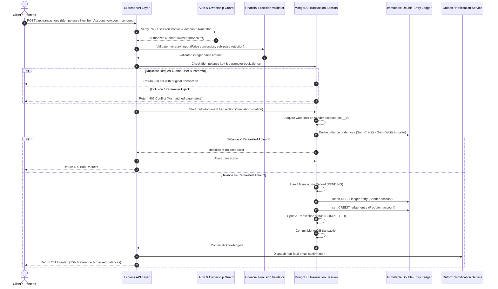

# 🏦 TRANSACT 2.0 | Next-Level Fintech Platform & Banking Ledger

[](https://nodejs.org/)
[](https://expressjs.com/)
[](https://react.dev/)
[](https://www.mongodb.com/)
[](https://helmetjs.github.io/)
[-brightgreen.svg)](Backend/test_suite.js)

**TRANSACT 2.0** is an enterprise-grade full-stack fintech banking platform and ledger management system. Designed for developer portfolios and production-style reliability, it features an **immutable double-entry accounting ledger**, **sub-paise integer financial precision**, **atomic multi-document MongoDB transactions**, **strict document-level write-locks to prevent double-spending**, **cryptographic idempotency protection**, **formula-injection-safe data exports**, **automated ledger reconciliation with compensating reversals**, **personal financial insights & analytics**, and a **dedicated Security Center & Admin Audit Trail**.

---

## 🏛️ System Architecture & Financial Lifecycle

### Atomic Funds Transfer Sequence


---

## 🛡️ Core Financial & Security Invariants

### 1. Zero Floating-Point Drift (Integer Paise Representation)
- All monetary operations throughout the backend are internally parsed, validated, and stored as **integer paise** ($1\text{ INR} = 100\text{ paise}$).
- Inputs with invalid sub-paise precision (e.g. `₹10.005` or `"50.1234"`), negative values, $0$, `NaN`, or `Infinity` are rejected with `400 Bad Request`.
- Balances are derived dynamically via MongoDB aggregation pipelines over immutable ledger records:
  $$\text{Balance}_{\text{paise}} = \sum \text{Credits}_{\text{paise}} - \sum \text{Debits}_{\text{paise}}$$
- Direct balance editing is strictly prohibited; balances are always an authoritative derived function of ledger postings.

### 2. Immutable Double-Entry Ledger
- Every funds transfer posts balanced **DEBIT** and **CREDIT** ledger entries atomically.
- Ledger documents are guarded by Mongoose middleware hooks prohibiting `updateOne`, `updateMany`, `deleteOne`, `deleteMany`, `findOneAndUpdate`, and `findOneAndDelete`.
- To correct an errant transfer, an authorized **compensating reversal transaction** is posted, preserving complete auditability.

### 3. Concurrency & Race-Safe Idempotency
- **Document Locking**: The sender's account document is write-locked inside the MongoDB transaction session, serializing competing requests and preventing race conditions or double-spending.
- **Idempotency with Parameter Binding**: A unique index on `idempotencyKey` prevents duplicate execution. The server checks that repeated submissions match the original sender, recipient, and amount.
- **409 Conflict Semantics**: Transient write conflicts or concurrent balance mutations safely return `409 Conflict` prompting client balance refresh without corrupting ledger state.

### 4. Public Account Numbers vs Internal IDs
- Public-facing **12-digit standard account numbers** (e.g. `104829104829`) keep MongoDB ObjectIds private while maintaining full backward compatibility.
- Recipient lookup endpoint (`/api/accounts/lookup`) resolves accounts and reveals privacy-safe masked names (e.g. `A**** E*******`) prior to transfer execution.

### 5. Application Security & Defense-in-Depth
- **HTTP Security Headers**: Enforced via Helmet.
- **CORS Allowlist**: Strict origin matching (`http://localhost:5173`, `http://localhost:3000`).
- **Rate Limiting**: Applied to authentication (`/api/auth/*`) and transfer endpoints (`/api/transactions/*`).
- **Input Limiting**: Request body limit constrained to `50kb`.
- **Environment Validation**: Startup validator halts boot if mandatory configuration (`MONGO_URI`, `JWT_SECRET`) is missing or insecure.
- **Production Error Masking**: Centralized error middleware shields stack traces and internal paths from external clients.
- **Formula Injection Protection**: CSV exports sanitize cells starting with `=`, `+`, `-`, `@`, `\t`, or `\r` (CWE-1236 defense).

---

## 📡 Complete API Reference

### Authentication (`/api/auth`)
| Method | Endpoint | Description | Auth |
| :--- | :--- | :--- | :--- |
| `POST` | `/api/auth/register` | Register new user with strong password checks | Public |
| `POST` | `/api/auth/login` | Authenticate & set secure HttpOnly cookie | Public |
| `GET` | `/api/auth/me` | Get sanitized profile of authenticated user | Bearer / Cookie |
| `POST` | `/api/auth/change-password` | Update user password with verification & audit log | Authenticated |
| `PATCH`| `/api/auth/preferences` | Update email notifications, login alerts, preferences | Authenticated |
| `GET` | `/api/auth/security-status` | Get password age, session security, and account health | Authenticated |
| `POST` | `/api/auth/logout` | Invalidate token via blacklist & clear cookie | Bearer / Cookie |

### Accounts (`/api/accounts`)
| Method | Endpoint | Description | Auth |
| :--- | :--- | :--- | :--- |
| `POST` | `/api/accounts/` | Create a new 12-digit digital bank account | Authenticated |
| `GET` | `/api/accounts/` | List all accounts of logged-in user with balances | Authenticated |
| `GET` | `/api/accounts/lookup` | Verify recipient name & status before transfer | Authenticated |
| `GET` | `/api/accounts/balance/:id`| Get real-time ledger balance for owned account | Owner only |
| `GET` | `/api/accounts/:id/statement`| Generate date-range account statement | Owner only |
| `PATCH`| `/api/accounts/:id/freeze` | Freeze account (blocks outgoing transfers) | Owner only |
| `PATCH`| `/api/accounts/:id/unfreeze`| Reactivate frozen account | Owner only |
| `PATCH`| `/api/accounts/:id/close` | Close account (strictly requires ₹0.00 balance) | Owner only |

### Transactions & Ledger (`/api/transactions`)
| Method | Endpoint | Description | Auth |
| :--- | :--- | :--- | :--- |
| `POST` | `/api/transactions/` | Execute atomic double-entry funds transfer | Owner only |
| `GET` | `/api/transactions/` | Get persistent paginated transaction history | Authenticated |
| `GET` | `/api/transactions/:id` | Get transaction details and ledger entries | Participant |
| `GET` | `/api/transactions/:id/receipt` | Generate official settlement receipt | Participant |
| `GET` | `/api/transactions/export/csv` | Download CSV export with formula injection defense | Authenticated |
| `POST` | `/api/transactions/system/initial-funds`| Admin authorized capital issuance | System User |
| `GET` | `/api/transactions/reconciliation/report`| Audit double-entry ledger balance integrity | System User |
| `POST` | `/api/transactions/:id/reverse`| Execute compensating reversal transaction | System User |

### Financial Insights (`/api/analytics`)
| Method | Endpoint | Description | Auth |
| :--- | :--- | :--- | :--- |
| `GET` | `/api/analytics/insights` | Inflow vs outflow analytics, velocity, savings rate | Authenticated |

### Administration & Audit (`/api/admin`)
| Method | Endpoint | Description | Auth |
| :--- | :--- | :--- | :--- |
| `GET` | `/api/admin/overview` | Platform-wide users, accounts, balance audit | System User |
| `GET` | `/api/admin/audit-logs` | Filterable administrative & security audit trail | System User |
| `GET` | `/api/admin/ledger-inspect/:identifier`| Low-level inspection of ledger postings by TXN/Account | System User |

### System & Health (`/api/health`)
| Method | Endpoint | Description | Auth |
| :--- | :--- | :--- | :--- |
| `GET` | `/api/health` | Service uptime, database connectivity status | Public |
| `GET` | `/` | Service root identification | Public |

---

## 📁 Repository Structure

```text
Bank Transaction System/
├── Backend/
│   ├── src/
│   │   ├── config/
│   │   │   ├── db.js                 # MongoDB connection & replica-set handler
│   │   │   └── env.validator.js      # Startup environment & secret validator
│   │   ├── controllers/
│   │   │   ├── auth.controller.js    # Register, login, profile, password change, security status
│   │   │   ├── account.controller.js # Account CRUD, lookup, freeze, unfreeze, safe closure
│   │   │   ├── transaction.controller.js # Atomic transfers, statements, receipts, CSV exports
│   │   │   ├── analytics.controller.js   # Financial insights & cash-flow summaries
│   │   │   └── admin.controller.js       # Admin overview, ledger inspector, audit logs
│   │   ├── middleware/
│   │   │   └── auth.middleware.js   # JWT verification, cookies, RBAC, systemUser guards
│   │   ├── models/
│   │   │   ├── user.model.js        # User model with preferences & password hashing
│   │   │   ├── account.model.js     # 12-digit account model with getBalance() aggregation
│   │   │   ├── transaction.model.js # Transaction record with unique reference & idempotency
│   │   │   ├── ledger.model.js      # Immutable double-entry ledger entries (paise storage)
│   │   │   ├── auditLog.model.js    # Security & administrative event audit trail
│   │   │   └── blackList.model.js   # JWT token blacklist with TTL index
│   │   ├── routes/
│   │   │   ├── auth.routes.js
│   │   │   ├── account.routes.js
│   │   │   ├── transaction.routes.js
│   │   │   ├── analytics.routes.js
│   │   │   └── admin.routes.js
│   │   ├── services/
│   │   │   ├── email.service.js     # Non-fatal email notification pipeline
│   │   │   └── reconciliation.service.js # Ledger reconciliation & reversal engine
│   │   ├── utils/
│   │   │   └── money.js             # Financial precision utilities (Paise <-> INR)
│   │   └── app.js                   # Express app with Helmet, CORS, Rate Limiters
│   ├── server.js                    # Server startup with graceful shutdown
│   ├── package.json
│   └── test_suite.js                # 61 automated end-to-end integration tests
│
├── Frontend/
│   ├── src/
│   │   ├── api/                     # Axios clients (auth, accounts, transactions, analytics, admin)
│   │   ├── components/
│   │   │   ├── accounts/            # AccountCard (12-digit, freeze/unfreeze), CreateAccountModal
│   │   │   ├── activity/            # ActivityTable with Receipt & Statement modals
│   │   │   ├── common/              # Modal, StatusBadge, CopyButton, Spinner
│   │   │   ├── dashboard/           # MainBalanceCard, QuickActions, StatCards
│   │   │   ├── layout/              # AppLayout, Sidebar, IconRail (Navigation items)
│   │   │   └── transactions/        # TransferForm with Recipient Verification & Review
│   │   ├── context/                 # AuthContext, AccountContext, ActivityContext, ToastContext
│   │   ├── pages/                   # Dashboard, Accounts, Transfer, Activity, Insights, SecurityCenter, AdminAudit, Settings
│   │   ├── utils/                   # Money formatting, Account ID masking, Idempotency generator
│   │   ├── App.jsx                  # React Router DOM configuration
│   │   ├── main.jsx                 # Application root
│   │   └── index.css                # Dark-mode glassmorphic design system
│   ├── vite.config.js               # Dev server with /api proxy
│   └── package.json
│
├── .env.example                     # Root sanitized environment template
├── .gitignore                       # Multi-directory secrets & build exclusions
└── README.md
```

---

## 🚀 Local Setup & Development

### 1. Prerequisites
- **Node.js**: v18.0.0 or higher
- **MongoDB**: MongoDB 5.0+ running with replica set support (required for multi-document transactions) or MongoDB Atlas cluster.

### 2. Environment Configuration
Copy `.env.example` to `Backend/.env`:
```bash
cp .env.example Backend/.env
```
Ensure `MONGO_URI` and `JWT_SECRET` are configured:
```env
PORT=3000
NODE_ENV=development
MONGO_URI=mongodb://localhost:27017/banking-system?replicaSet=rs0
JWT_SECRET=super_secret_jwt_key_at_least_32_characters_long
CORS_ORIGIN=http://localhost:5173,http://localhost:3000
```

### 3. Start Backend
```bash
cd Backend
npm install
npm run dev
```
Backend starts on `http://localhost:3000`.

### 4. Start Frontend
```bash
cd Frontend
npm install
npm run dev
```
Frontend starts on `http://localhost:5173`.

---

## 🧪 Automated Testing & Verification

The backend includes a comprehensive automated test suite running against an in-memory MongoDB replica set (`mongodb-memory-server`):
```bash
cd Backend
npm test
```

### Test Coverage (61 Integration Tests, 0 Failed):
1. **Authentication & Security (6 tests)**: Registration, duplicate email rejection (422), system user flag, invalid password rejection (401), sanitized `/api/auth/me`.
2. **Accounts & Ownership Protection (5 tests)**: Account creation, listing, initial ₹0.00 balance, foreign account balance isolation (404).
3. **System Initial Funding (4 tests)**: Normal user 403 Forbidden, authorized capital issuance, balance updates, zero negative accounts.
4. **Transfer Validation & Security (8 tests)**: Rejection of zero, negative, NaN amounts, self-transfers, foreign sender account attacks, frozen accounts, and insufficient funds.
5. **Idempotency & Deduplication (3 tests)**: Replay returns original transaction (200), balances deducted exactly once, foreign key hijacking rejected (409 Conflict).
6. **Concurrency & Double-Spend Defense (2 tests)**: Concurrent requests competing for same balance serialized safely under lock without double-spending.
7. **Ledger Immutability (1 test)**: Direct ledger record update prohibited by hooks.
8. **Transaction Rollbacks (2 tests)**: Aborted multi-document transactions clean up both transaction and ledger entries.
9. **Session & Token Blacklist (2 tests)**: Logout succeeds and blacklisted token access is rejected (401).
10. **Financial Precision & Edge Cases (3 tests)**: Sub-paise fractional amounts (`10.005`) rejected, excessive string decimal precision (`"50.1234"`) rejected, limit over ₹10,00,000 rejected.
11. **Persistent History, Receipts & Statements (7 tests)**: Recipient lookup with privacy masking, self-lookup detection, paginated transaction history, transaction details with ledger postings, printable receipts, account statements with opening/closing balances, and formula-injection-safe CSV export.
12. **Account Lifecycle & Safe Closure (5 tests)**: Account freeze, transfer block while frozen, unfreeze reactivation, closing non-zero balance rejected (400), zero-balance account closure succeeds.
13. **Reconciliation & Reversals (2 tests)**: Non-admin reconciliation blocked (403), system admin reconciliation audits and confirms balanced ledger.
14. **Health & Runtime Monitoring (1 test)**: Health endpoint reports service uptime and connected database status.
15. **Security Center & Password Lifecycle (3 tests)**: Current password verification, min 8-char validation, preference updates, security status reporting.
16. **Financial Insights & Analytics (1 test)**: Dynamic monthly cash flow calculation and spending breakdown.
17. **Administration & System Audit Trail (3 tests)**: Non-admin 403 enforcement, system liquidity overview audit, paginated security audit trail.

### Production Build Validation
```bash
cd Frontend
npm run build
```
Builds cleanly with zero errors in ~2.4s.

---

## 📋 Security Checklist

- [x] Environment files (`.env`, `.env.*`) ignored by git in root and all subdirectories.
- [x] Sanitized `.env.example` templates provided.
- [x] Server validates required environment variables at startup and fails safely if missing.
- [x] Secure HTTP headers applied via Helmet.
- [x] Explicit CORS allowlist configured.
- [x] Rate limiting configured on authentication and financial endpoints.
- [x] Request payload size limits enforced (50kb).
- [x] Centralized error handler shields stack traces and internal database errors in production.
- [x] Passwords hashed with bcrypt (salt rounds = 10).
- [x] Generic authentication error messages to prevent account enumeration.
- [x] HttpOnly, SameSite, and Secure flags configured on session cookies.
- [x] Server-side token blacklist table invalidates logged-out JWTs.
- [x] Integer paise financial precision prevents JavaScript floating point arithmetic drift.
- [x] Double-entry ledger architecture with debit/credit balance verification.
- [x] Document-level write locking prevents concurrent double-spending.
- [x] Idempotency keys bound to sender, recipient, and transfer amount.
- [x] CSV export protected against spreadsheet formula injection (CWE-1236).
- [x] Reconciliation service audits ledger integrity for orphaned or unbalanced entries.
- [x] Safe account closure enforced (closing accounts with non-zero balances blocked).
- [x] Dedicated Security Center with password rotation, login notifications, and account freeze toggles.
- [x] Role-based Admin Audit view for reviewing ledger balances, user accounts, and immutable audit logs.

---

## ⚖️ Portfolio Disclaimer
This project is an advanced full-stack financial simulation and engineering portfolio piece demonstrating high-availability ledger concepts, race condition prevention, and secure web application design. For production deployment in regulated financial institutions, integration with certified banking gateways, multi-factor hardware authentication, HSM key stores, and formal regulatory compliance (PCI-DSS / RBI / FINCEN) is required.
